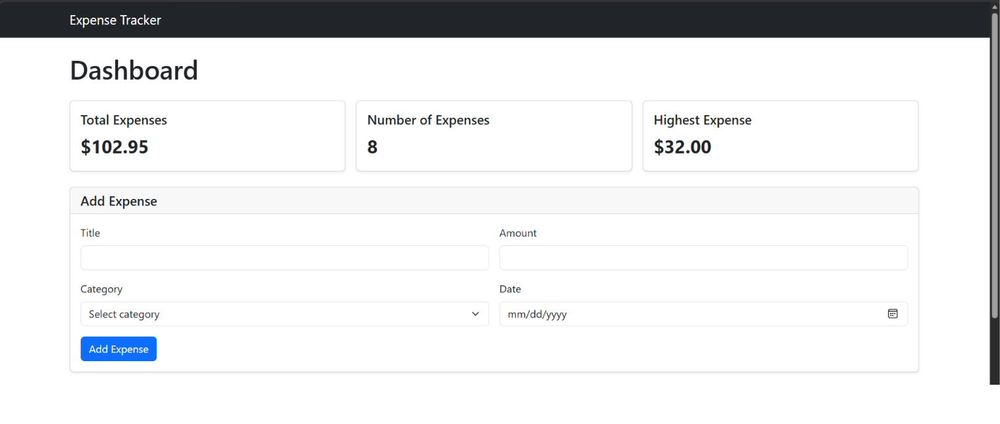
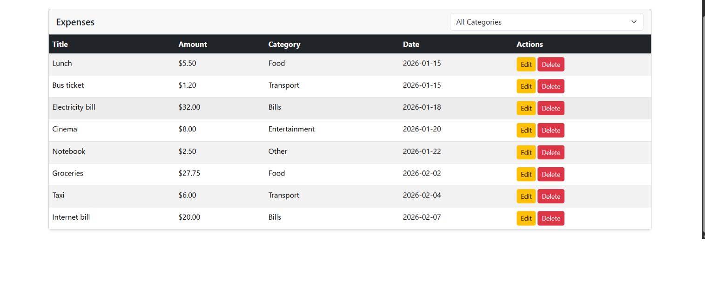
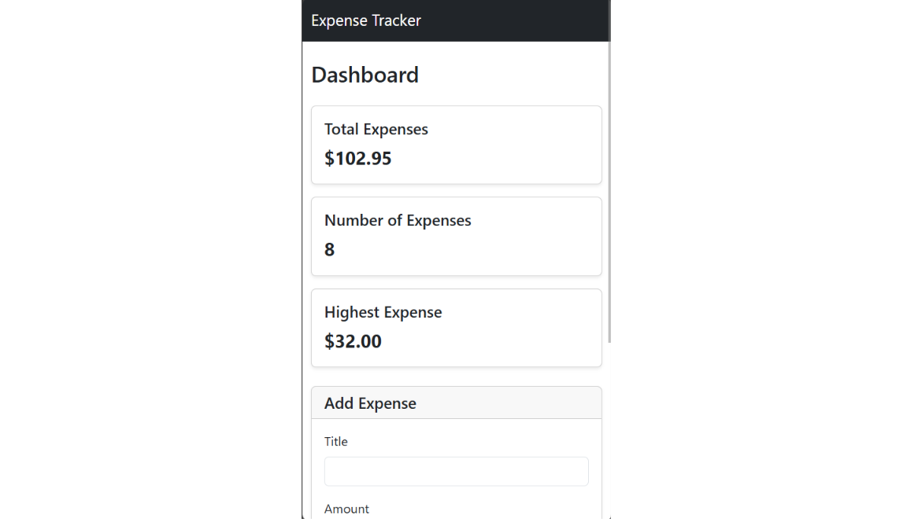

# Expense Tracker

Expense Tracker is a full-stack web application that allows users to manage their daily expenses. It supports adding, editing, deleting, and filtering expenses by category, with summary cards displaying the total amount, number of expenses, and highest expense.

## How to Run

### Prerequisites

Make sure you have the following installed:

- Node.js and npm
- PostgreSQL
- Visual Studio Code

### Backend

1. Open the project folder in Visual Studio Code.
2. Open a terminal and navigate to the backend directory:

   ```bash
   cd backend
   ```

3. Install the required dependencies:

   ```bash
   npm install
   ```

4. Open PostgreSQL using pgAdmin and create a database named `expense_tracker`.

5. Open the `schema.sql` file in pgAdmin, select the `expense_tracker` database, and execute the script to create the expenses table and insert the sample data.

6. Create a `.env` file inside the `backend` directory with the following configuration:

   ```env
   DB_HOST=localhost
   DB_PORT=5432
   DB_NAME=expense_tracker
   DB_USER=postgres
   DB_PASSWORD=your_postgresql_password
   ```

   Replace `your_postgresql_password` with your actual PostgreSQL password.

7. Start the backend server:

   ```bash
   npm start
   ```

8. Verify that the API is running by opening:

   `http://localhost:3000/api/health`

### Frontend

1. Open the `frontend` directory in Visual Studio Code.
2. Open `index.html` using the Live Server extension.
3. Make sure the backend server is running at `http://localhost:3000`.
4. The Expense Tracker dashboard should load and retrieve the expenses from PostgreSQL through the API.

## Features

- [x] Add an expense with validation
- [x] Delete an expense
- [x] Edit an expense
- [x] Filter by category
- [x] Summary cards (total, count, highest)
- [x] Data is saved in a PostgreSQL database
- [x] Loading spinner while loading expenses
- [x] Success and error alerts
- [x] Responsive layout for desktop and mobile

## Screenshots

## Screenshots

### Desktop Dashboard


### Expenses Table


### Mobile Dashboard


## What Was the Hardest Part?

The most challenging part was connecting the frontend to the backend API and ensuring that all CRUD operations worked correctly with PostgreSQL. I solved this by using JavaScript's `fetch` and `async/await`, handling errors with `try/catch`, validating user input, and refreshing the displayed data after each successful operation.
